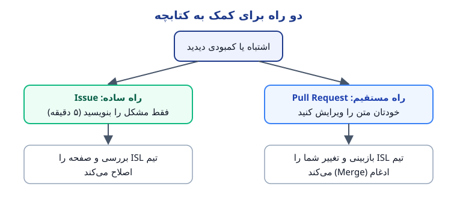
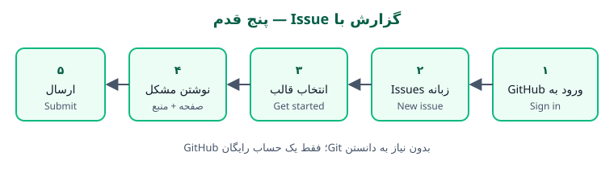
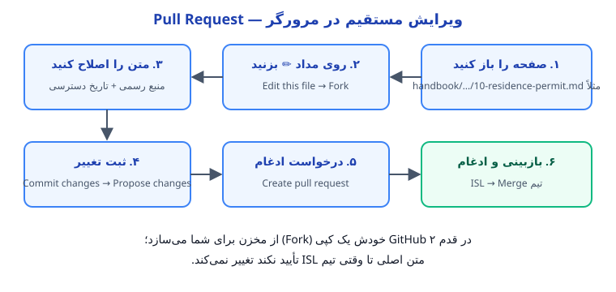

# ۶۴. راهنمای GitHub و مشارکت در این کتابچه — قدم‌به‌قدم، با شکل

<!-- disclaimer:start -->
> [!CAUTION]
> ### ⚠️ این کتابچه فقط راهنما و حاصل تجربه دانشجویان است — نه قانون و نه مشاوره رسمی
>
> **قوانین، مبالغ، مهلت‌ها و روندهای اداری ممکن است هر زمان و بدون اطلاع قبلی تغییر کنند.** انجمن دانشجویان ایرانی دانشگاه لایبنیتس هانوفر (ISL) و نویسندگان این کتابچه **هیچ مسئولیتی** در قبال درستی، کامل بودن یا به‌روز بودن مطالب و پیامد استفاده از آن‌ها ندارند. پیش از هر اقدام، اطلاعات را از نهاد رسمی مسئول بپرسید؛ ملاک نهایی همیشه همان نهاد است.
>
> ### 🗓️ آخرین به‌روزرسانی این صفحه: ⁦2026-10-25⁩
>
> از تغییرات بعدی باخبر شوید: [فهرست تغییرات (CHANGELOG)](../../CHANGELOG.md) · در GitHub روی **Watch** بزنید · [کانال تلگرام ISL](https://t.me/hannover_iranian_students)
<!-- disclaimer:end -->

> [!TIP]
> **تاریخ آخرین بررسی:** 2026-10-25 · **بخش:** [بخش ۷ — منابع و پیوست‌ها](README.md) · **تاریخ دسترسی به منابع:** 2026-10-25 · **راهنما:** ⚠️ = نیازمند تأیید یا تکمیل؛ ℹ️ = نکته

## ۱. هدف

این کتابچه را دانشجوها برای دانشجوها می‌نویسند، و هر کسی می‌تواند کمک کند؛ حتی اگر تا امروز اسم GitHub را هم نشنیده باشد. این صفحه نشان می‌دهد چطور یک اشتباه را گزارش کنید، چطور خودتان متنی را اصلاح کنید، و پشت صحنه چه اتفاقی می‌افتد.

## ۲. چه کسی به آن نیاز دارد؟

- هر کسی که در کتابچه اشتباه، پیوند خراب یا کمبودی دیده است.
- هر کسی که تجربه‌ای دارد که به تازه‌واردها کمک می‌کند.
- اعضای ISL که کتابچه را نگهداری می‌کنند.

## ۳. مراحل انجام کار

### الف) GitHub چیست؟ در یک دقیقه

- **GitHub** سایتی است که متن این کتابچه را نگه می‌دارد و هر تغییری را با تاریخ و نام ثبت می‌کند؛ برای همین هیچ نسخه‌ای گم نمی‌شود.
- **مخزن (Repository):** پوشه اصلی کتابچه: [github.com/FreeXYZ-HalfPI/Hannover-Handbook-ISL](https://github.com/FreeXYZ-HalfPI/Hannover-Handbook-ISL).
- **Issue:** یک یادداشت عمومی برای گزارش مشکل یا پیشنهاد. مثل نامه به تیم کتابچه.
- **Pull Request (PR):** پیشنهاد تغییر در خود متن. تیم ISL آن را می‌خواند و اگر درست بود، ادغام (Merge) می‌کند.
- **Fork:** کپی شخصی شما از مخزن؛ GitHub خودش هنگام ویرایش آن را می‌سازد.



### ب) قدم صفر: ساختن حساب رایگان

1.  به [github.com/signup](https://github.com/signup) بروید و با ایمیل خود حساب رایگان بسازید ([GitHub Docs – Creating an account](https://docs.github.com/en/get-started/start-your-journey/creating-an-account-on-github)).
2.  ℹ️ نام کاربری شما در Issueها و تغییرها عمومی دیده می‌شود؛ اگر نمی‌خواهید نام واقعی‌تان دیده شود، نام کاربری خنثی انتخاب کنید.

### پ) راه ساده: گزارش با Issue (بدون دانستن Git)



1.  وارد حساب GitHub شوید و به [زبانه Issues مخزن](https://github.com/FreeXYZ-HalfPI/Hannover-Handbook-ISL/issues) بروید.
2.  روی **New issue** بزنید.
3.  یکی از سه قالب را انتخاب کنید ([انتخاب قالب](https://github.com/FreeXYZ-HalfPI/Hannover-Handbook-ISL/issues/new/choose)):
    - **Broken link or wrong information · پیوند خراب یا اطلاعات نادرست** — عدد، مهلت یا پیوندی که درست نیست.
    - **Share an experience · ثبت تجربه** — تجربه شخصی شما با تاریخ.
    - **Suggest a new topic · پیشنهاد موضوع تازه** — موضوعی که در کتابچه نیست.
4.  فرم را پر کنید: کدام صفحه، چه چیزی اشتباه است، و **منبع رسمی درست** (اگر دارید).
5.  روی **Submit new issue** بزنید. تیم ISL پاسخ می‌دهد و صفحه را اصلاح می‌کند ([GitHub Docs – Creating an issue](https://docs.github.com/en/issues/tracking-your-work-with-issues/using-issues/creating-an-issue)).

### ت) راه مستقیم: ویرایش در مرورگر با Pull Request



1.  صفحه‌ای را که می‌خواهید اصلاح کنید در مخزن باز کنید (مثلاً `handbook/01-arriving-in-hannover/10-residence-permit.md`).
2.  بالای متن روی آیکون مداد **✏️ (Edit this file)** بزنید. اگر عضو تیم نیستید، GitHub می‌پرسد آیا مخزن را **Fork** کند؛ تأیید کنید.
3.  متن را اصلاح کنید. **قاعده اصلی:** هر عدد، مهلت یا هزینه تازه باید کنار خودش پیوند منبع رسمی داشته باشد و در جدول بخش ۶ همان صفحه با **تاریخ دسترسی** ثبت شود. ← [CONTRIBUTING.md](../../CONTRIBUTING.md)
4.  پایین یا بالای صفحه روی **Commit changes…** بزنید، یک جمله کوتاه درباره تغییر بنویسید (مثلاً «به‌روزرسانی هزینه اقامت ۲۰۲۷») و **Propose changes** را بزنید.
5.  در صفحه بعد **Create pull request** را بزنید. چک‌لیست قالب PR را تیک بزنید.
6.  تیم ISL تغییر را می‌خواند؛ شاید سؤالی بپرسد. پس از تأیید، تغییر **Merge** می‌شود و در نسخه بعدی PDF هم می‌آید ([GitHub Docs – Editing files](https://docs.github.com/en/repositories/working-with-files/managing-files/editing-files)؛ [GitHub Docs – Creating a pull request](https://docs.github.com/en/pull-requests/collaborating-with-pull-requests/proposing-changes-to-your-work-with-pull-requests/creating-a-pull-request)).

### ث) صفحه تازه

1.  فایل [TEMPLATE.md](../../TEMPLATE.md) را باز کنید و ساختار هفت‌بخشی آن را نگه دارید.
2.  در پوشه بخش مناسب فایل تازه بسازید (**Add file → Create new file**)، با نامی مثل `65-topic-name.md`.
3.  پیوند صفحه را به `README.md` همان بخش و به [فهرست کتابچه](../README.md) اضافه کنید.
4.  مثل بالا Pull Request بسازید.

### ج) برای کسانی که با Git کار می‌کنند

```bash
git clone https://github.com/FreeXYZ-HalfPI/Hannover-Handbook-ISL.git
cd Hannover-Handbook-ISL
git switch -c fix-residence-fee
# فایل را ویرایش کنید
git add handbook/01-arriving-in-hannover/10-residence-permit.md
git commit -m "Update residence permit fee for 2027"
git push origin fix-residence-fee
```

سپس در GitHub روی **Compare & pull request** بزنید. پیش از فرستادن، پیوندها را بررسی کنید (`bash tools/check_links.sh`) و اگر می‌توانید PDF را بسازید (`python3 tools/build_pdf.py`). ← [README](../../README.md)

### چ) قواعد طلایی

1.  **منبع رسمی برای هر ادعا**، با تاریخ دسترسی.
2.  **تجربه شخصی فقط در بخش ۷** و همیشه با تاریخ.
3.  **هیچ داده شخصی:** نام دیگران، شماره تلفن، ایمیل، نشانی دقیق، شماره پاسپورت یا عکس مدارک ننویسید؛ نه در صفحه‌ها و نه در Issueها.
4.  **ساده و انسانی بنویسید:** طوری که برای یک دوست تازه‌وارد توضیح می‌دهید؛ جمله کوتاه، اصطلاح آلمانی در پرانتز.

## ۴. مدارک و هزینه‌ها

| مورد | الزامی / احتمالی | توضیح | منبع |
|----|----|----|----|
| حساب GitHub | الزامی | رایگان | [GitHub Docs](https://docs.github.com/en/get-started/start-your-journey/creating-an-account-on-github) |
| دانستن Git | احتمالی | فقط برای راه «ج»؛ برای Issue و ویرایش در مرورگر لازم نیست | — |

## ۵. نهاد مسئول

- **نگهداری کتابچه:** انجمن دانشجویان ایرانی دانشگاه لایبنیتس هانوفر (ISL) — Iranische Studierendenvereinigung der Leibniz Universität Hannover
- **راه تماس:** [Issueهای مخزن](https://github.com/FreeXYZ-HalfPI/Hannover-Handbook-ISL/issues)

## ۶. منابع و پیوندهای رسمی

همه پیوندهای این صفحه در «تاریخ دسترسی» بررسی شده‌اند و نتیجه هر کدام در ستون آخر آمده است. اگر پیوندی کار نمی‌کند، آن را در صفحه ۵۷ گزارش دهید.

| \# | منبع | ناشر | تاریخ دسترسی | نتیجه بررسی |
|----|----|----|----|----|
| ۱ | [Creating an account on GitHub](https://docs.github.com/en/get-started/start-your-journey/creating-an-account-on-github) | GitHub Docs | 2026-10-25 | ✅ باز شد |
| ۲ | [Creating an issue](https://docs.github.com/en/issues/tracking-your-work-with-issues/using-issues/creating-an-issue) | GitHub Docs | 2026-10-25 | ✅ باز شد |
| ۳ | [Editing files](https://docs.github.com/en/repositories/working-with-files/managing-files/editing-files) | GitHub Docs | 2026-10-25 | ✅ باز شد |
| ۴ | [Creating a pull request](https://docs.github.com/en/pull-requests/collaborating-with-pull-requests/proposing-changes-to-your-work-with-pull-requests/creating-a-pull-request) | GitHub Docs | 2026-10-25 | ✅ باز شد |

## ۷. تجربه دانشجویان (غیررسمی)

> [!NOTE]
> این بخش برای تجربه‌های شخصی است و قاعده عمومی یا مشاوره حقوقی به شمار نمی‌آید. تجربه خود را با ذکر تاریخ در [صفحه ۵۷](57-contribute-experiences.md) یا از طریق یک Issue در GitHub بفرستید.

- هنوز تجربه‌ای ثبت نشده است. اولین Issue شما می‌تواند اولین تجربه این صفحه باشد.

---

> تهیه و تنظیم: **انجمن دانشجویان ایرانی دانشگاه لایبنیتس هانوفر (ISL)**
>
> *Iranische Studierendenvereinigung der Leibniz Universität Hannover (ISL)*
>
> *Iranian Student Association of Leibniz University Hannover (ISL)*
